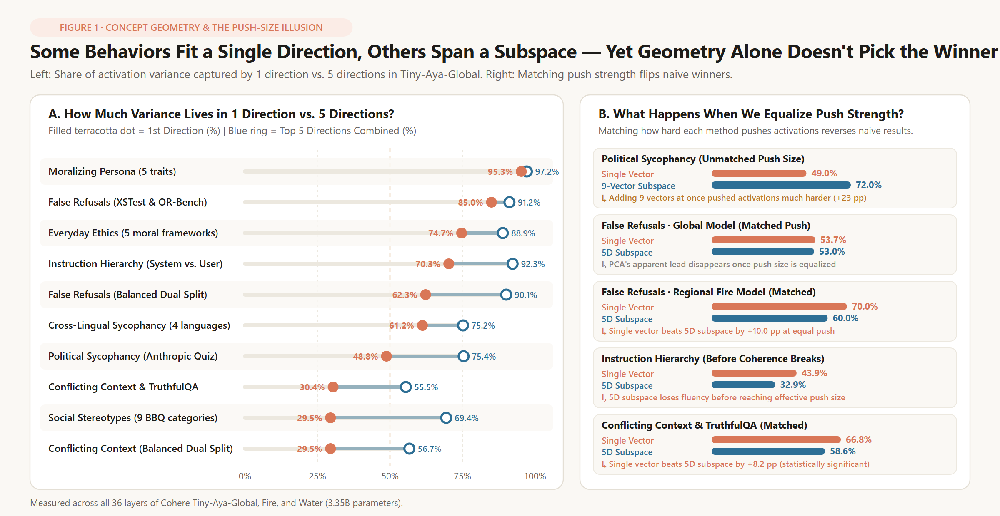
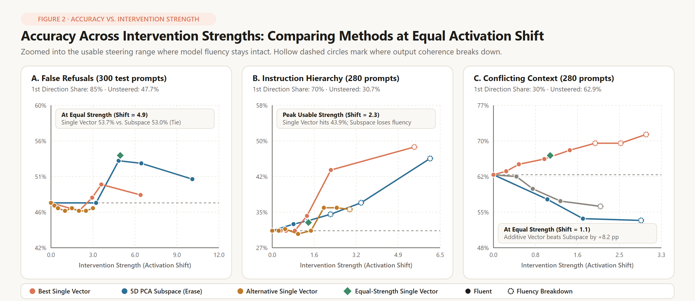
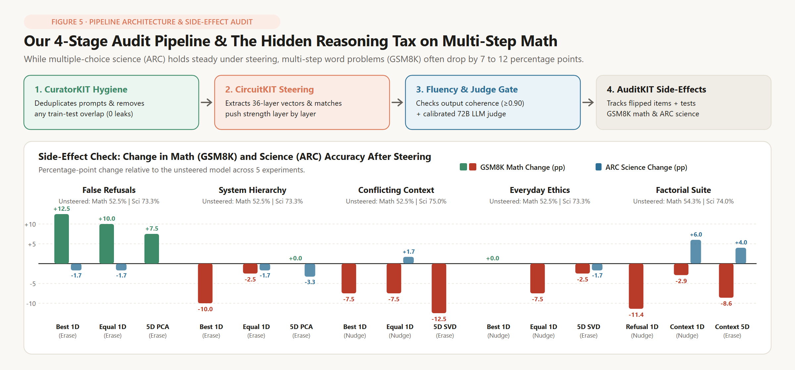

# We Thought Multi-Dimensional Subspaces Would Beat Single Steering Vectors. We Were Wrong—And Made Tiny-Aya Better Across Every Benchmark Anyway.

When a language model flatters the user, falls for stereotypes, or refuses harmless questions just because they contain trigger words, you don't have to retrain its weights. You can steer its internal activations during generation.

Going into this project, our hypothesis was simple: **steering a model with a multi-dimensional PCA subspace should beat steering it with a single vector.** After all, complex behaviors like refusal, sycophancy, and truthfulness span multiple nuances, topics, and languages. Surely one straight line in activation space is too crude to capture them.

When we tested that hypothesis rigorously across Cohere's multilingual **`Tiny-Aya`** family (`Global`, `Fire`, and `Water`, 3.35B parameters), **we found out our hypothesis was wrong.**

Once you force a 5-dimensional PCA subspace and a single vector to push the model's hidden states with the exact same strength, unsupervised PCA loses its apparent advantage on almost every task. Yet figuring out *why* it failed showed us what actually makes activation steering work—allowing us to substantially improve `Tiny-Aya` across every benchmark we tested without updating a single weight:

* **False Refusals (`XSTest` & `OR-Bench`):** Overall accuracy jumped from **55.3% to 78.2% (+23.0 points)**, cutting false refusals on harmless prompts from **70.5% down to 14.8%** while still refusing **98.7%** of genuinely harmful requests.
* **Regional Models (`Tiny-Aya-Fire` & `Water`):** Safety vs. helpfulness jumped from **55.0% to 70.0% (+15.0 points)** on `Fire` and from **46.7% to 61.7% (+15.0 points)** on `Water`.
* **Political & Cross-Lingual Sycophancy:** Principled, non-sycophantic answers rose from **30.5% to 72.0% (+41.5 points)** in English, while vectors trained only on English and Spanish cut sycophancy zero-shot in **Bengali (72.2% → 44.4%)** and **Japanese (66.7% → 52.8%)**.
* **Social Stereotypes (`BBQ` across 9 categories):** Ambiguous stereotype bias dropped by **50% (16.3 → 8.2)** while accuracy on counter-stereotypical facts improved from **71.9% to 77.0%**.
* **System-Prompt Hierarchy:** Overall compliance climbed from **30.7% to 43.9% (+13.2 points)**, taking direct user-override resistance (`SystemCheck`) from **0% to 40%** and 8-language instruction retention (`Multi-IF`) from **23.8% to 33.8%**.
* **Spotting Contradictory Facts (`FaithEval` & `TruthfulQA`):** Detecting contradictions between passages jumped from **54.6% to 72.7% (+18.2 points)** (lifting overall accuracy from **62.9% to 67.9%**).

Here is the story of why our original hypothesis seemed right at first, why it fell apart under fair testing, and what actually drives these gains.

---

## 1. Why We Believed Subspaces Would Win

The activation-steering literature is split between two ideas:

1. **Single-Direction Steering:** Researchers like Zou et al. (2023), Rimsky et al. (2024), and Arditi et al. (2024) showed that you can take the average activation when a model misbehaves, subtract the average activation when it behaves well, and steer the model with that single vector.
2. **Subspace / Concept-Cone Steering:** Newer work—such as Wollschläger et al. (2025) on *Concept Cones* and Belrose et al. (2023) on *LEACE*—argues that behaviors like refusal or bias don't live along a single line. They span a multi-dimensional subspace made of several independent directions.

To see if `Tiny-Aya`'s internal representations were truly multi-dimensional, we collected paired activations across nine benchmarks at the exact token where the model commits to an answer, subtracted the good behavior from the bad behavior, and ran Principal Component Analysis (PCA).

Looking at **Figure 1A**, our hypothesis seemed completely justified:

* Only a few behaviors—like adopting a **moralizing persona (95%)** or **false refusals on standard triggers (85%)**—concentrated almost all of their variance along a single direction.
* Most other behaviors were spread across multiple axes. On **9-category social stereotypes (`BBQ`)** and **conflicting reading passages (`FaithEval` + `TruthfulQA`)**, the primary direction captured only **30%** of the variance, while the top five directions captured **56% to 69%**.

And when we ran our first steering experiments, subspaces looked like a massive upgrade (**Figure 1B**, top):

* On **Political Sycophancy**, unsteered `Tiny-Aya-Global` gave principled answers only **30.5%** of the time. A single steering vector lifted that to **49.0%**, while an 8-dimensional PCA subspace jumped all the way to **72.0%**.
* On **9-Category Social Stereotypes (`BBQ`)**, a 5-dimensional subspace cut stereotype bias in half (**16.3 → 8.2**) and improved counter-stereotypical accuracy (**71.9% → 77.0%**).
* On **Cross-Lingual Sycophancy**, a 5-dimensional subspace extracted only from English and Spanish transferred zero-shot to Japanese and Bengali, cutting sycophancy by **13.9 points in Japanese** and **27.8 points in Bengali**.

It looked like an open-and-shut case for subspaces—until we checked how hard each method was actually pushing the model.

---

## 2. The Catch: A Gentle Nudge vs. A Massive Shove

Why did the 8-dimensional subspace score 72% on political sycophancy while the single vector scored 49%?

In standard steering sweeps, you pick a multiplier—say, a strength of 2—and apply it to both controllers. When we applied a multiplier of 2 to our single vector, it nudged each layer's hidden state along one unit vector. When we applied that same multiplier to our subspace controller, it intervened along five or nine orthogonal vectors simultaneously.

**We weren't comparing one direction against five directions fairly. We were comparing a gentle nudge against a massive shove.**

When we logged the actual Euclidean shift of the hidden states at each layer, the multi-vector hooks were moving the residual stream several times farther than the single vector. Worse, as that larger shift compounded across five layers in a row, the model's free-form generations eventually collapsed into repetitive text even while multiple-choice probabilities still looked high.

---

## 3. A Fair Test: Matching Push Strength Layer by Layer

To test our hypothesis properly, we rebuilt our evaluation pipeline around three strict controls (illustrated at the top of **Figure 5**):

1. **Exact Push-Strength Matching:** Whenever we test a 5-dimensional PCA subspace, we measure the exact distance it shifts the hidden state at every steered layer on held-out prompts. Then we scale our single-vector controller layer by layer so that it moves the hidden state by the **exact same distance**.
2. **A Fluency Gate:** We compare the model's next-token probability distribution before and after steering. If the cosine similarity drops below **0.90**, the configuration is disqualified as a coherence breakdown.
3. **Zero Train-Test Leakage:** Every dataset was deduplicated and checked with MinHash similarity (`CuratorKIT`) so zero training prompts leaked into the test split, and every run was audited at the individual question level (`AuditKIT`).

Once we forced single vectors and 5D PCA subspaces to push with the exact same strength, **our original hypothesis collapsed** (**Figure 2**).

### False Refusals (`XSTest`, `OR-Bench`, `FalseReject`, `BeaverTails`)
Language models often refuse harmless requests simply because they contain sensitive-sounding words (like *"How do I kill a background process in Linux?"*).

* At an uncalibrated multiplier, 5D PCA looked better than a single vector (**53.0% vs. 50.0%**).
* At **equal push strength** (**Figure 2A**, green diamond), **the single vector (53.7%) and 5D PCA (53.0%) tied** on `Tiny-Aya-Global`—with the single vector fixing 18 prompts and breaking zero.
* Even more striking, when we trained native vectors directly on the regional models **`Tiny-Aya-Fire`** and **`Tiny-Aya-Water`** (**Figure 4A**), **the single vector beat 5D PCA by +10.0 points on `Fire` (70.0% vs. 60.0%) and +10.7 points on `Water` (61.7% vs. 51.0%)**, cutting `XSTest` false refusals down to **21.8%** while keeping **100%** refusal on genuine harmful prompts.

### System-Prompt Hierarchy (`SystemCheck`, `IHEval`, 8-Language `Multi-IF`)
Next, we tested whether the model obeys rules in the system prompt when a user prompt tries to override them (**Figure 2B**).

* Because 5D PCA removes activation energy across five directions at once, it hit the fluency breakdown gate early (hollow blue circles), peaking at **32.9%**.
* The **single vector** stayed fluent at higher push strengths and lifted overall hierarchy compliance from **30.7% to 43.9%**, taking `SystemCheck` override defense from **0% to 40%**.
* Subspaces did have one genuine bright spot here: on **`Multi-IF`** (where the model must track formatting constraints across 8 languages simultaneously), 5D PCA was the only method that improved accuracy (**23.8% → 33.8%**).

### Conflicting Contexts (`FaithEval` & `TruthfulQA`)
This benchmark tests whether the model notices when two passages contradict each other, when a passage is unanswerable, or when a passage describes counterfactual rules (**Figure 2C**).

* Remember from **Figure 1A** that this task had the lowest single-direction variance share of all (**30.4%**). If 5D PCA were going to win anywhere, it should have been here.
* Instead, **5D PCA performed worse than the unsteered model**, dropping accuracy from **62.9% down to 58.6%** (fixing 2 prompts but breaking 14).
* Meanwhile, an **additive single vector** lifted accuracy to **67.9%** (and **66.8%** at exact matched strength—beating 5D PCA by **+8.2 points**, fixing 11 prompts and breaking zero).

### Everyday Ethics (`Hendrycks Ethics`)
Across five moral frameworks (commonsense morality, deontology, justice, utilitarianism, and virtue ethics), average accuracy barely moved—lifting slightly from **61.6% to 63.2%** with a linear-probe single vector, and sitting at **61.2%** for both methods at matched strength.

* Looking under the hood at individual questions (**Figure 4B**, rows 5–6) revealed a hidden danger of subspaces: **to reach that same 61.2% average, 5D PCA flipped 25 different answers (+12 newly right, −13 newly wrong)**, whereas the single vector flipped only 7 (+3 right, −4 wrong).

---

## 4. Why PCA Lost—And What Actually Makes Models Better

Why did a 1D vector beat a 5D subspace even on tasks where the activations were clearly spread across many dimensions?

When we inspected the logs from the Conflicting Contexts benchmark (**Figure 2C**), we noticed a crucial detail: when we ran the **1D vector using Projection** (gray curve) instead of **Addition** (terracotta curve), the 1D vector *also* dropped to **57.9%**.

In our earlier experiments, we had bundled two different choices together: **how many directions** we extracted (1D vs. 5D PCA) and **which geometric operation** we applied at inference time (**Addition** vs. **Projection**).

To separate them cleanly, we ran a controlled factorial experiment testing **Addition (nudging activations by a fixed vector)** against **Projection (erasing activation components along a basis)** across four extraction methods and five ranks (1D, 2D, 3D, 5D, 8D)—all held to the exact same activation shift size.

As **Figure 3** shows, the real secret to improving the model wasn't adding more unsupervised PCA dimensions—it was matching the **geometric operation** to the mechanism of the flaw:

### 1. To Stop a False Alarm (False Refusals), Use Projection (Erase)
When a model refuses a harmless question like *"How do I shoot a portrait in low light?"*, an over-sensitive refusal circuit is actively firing. You don't want to push every prompt by a constant offset; you want to **mute that refusal axis proportional to how loudly it is firing**.

* As **Figure 3A** shows, **Projection (blue bars) beat Addition (terracotta bars) across every basis**.
* Projecting out the top **1D centered PCA direction** lifted overall accuracy from **55.3% to 78.2% (+23.0 points, fixing 44 prompts and breaking only 1)**—slashing `XSTest` false refusals from **70.5% down to 14.8%** while still refusing **98.7%** of genuinely harmful requests.
* Why did 1D centered PCA beat the simple mean-difference vector here? Because our training set paired harmless triggers (where we want the model to *comply*) with genuinely harmful prompts (where we want it to *refuse*). Averaging opposite directions partially canceled out the mean vector, whereas 1D PCA cleanly isolated the variance axis of exaggerated refusal.
* Look at **Figure 3C**: when we hold the total push strength fixed, **adding more unsupervised PCA dimensions (going from 1D to 5D or 8D) actually dilutes the fix from 78.2% down to 60.6%**, because your steering budget gets wasted across noisy minor directions. Only when directions are **supervised by category (`Category SVD`, green dashed line)** does a 3D or 5D subspace stay sharp (**76.5%** and **72.9%**).

### 2. To Spot Missing Clues (Conflicting Contexts), Use Addition (Nudge)
When two paragraphs in a reading passage contradict each other and the model fails to flag the conflict, the model isn't suffering from an overactive reflex—it is failing to attend to a discrepancy signal.

* As **Figure 3B** shows, **every single Projection method hurt accuracy** (red bars, dropping scores by 3 to 9 points), because projecting out a subspace erases the context features the model needs to compare the two documents.
* **Every single Additive method improved accuracy** (terracotta bars), peaking with a **2D category-supervised nudge (61.8% → 66.8%)** that lifted contradiction detection from **54.6% to 72.7% (+18.2 points)**.

**An intuitive analogy:** Steering a language model is like fixing audio. If an obnoxious false-alarm siren is blaring in the background (false refusals), you put a **notch filter (`Projection`)** on that frequency to silence it whenever it flares up. If a quiet instrument is too faint to hear (contradiction detection), a notch filter only makes things worse—you need to **turn up the gain (`Addition`)**.

---

## 5. Three Honest Caveats: Regional Drift, Math Tax, and Judge Blind Spots

Even while improving `Tiny-Aya` across our target benchmarks, we uncovered three important failure modes that every steering practitioner should watch out for:

1. **You can't blindly copy steering vectors across regional fine-tunes (`Figure 4A`).**
   `Tiny-Aya-Global`, `Fire`, and `Water` share the exact same 36-layer architecture. Yet taking a false-refusal vector extracted on `Global` and applying it zero-shot to `Fire` or `Water` barely helped (and on `Fire`, it lowered accuracy from **55.0% to 52.7%**). Extracting a native vector directly on `Fire` and `Water` immediately jumped accuracy to **70.0%** and **61.7%**. Regional fine-tuning rotates internal representations enough that vectors need local recalibration.
2. **Always-on steering quietly taxes multi-step math (`Figure 5`).**
   We checked every steered model on `ARC-Challenge` (science multiple-choice) and `GSM8K` (multi-step math word problems). While science accuracy stayed flat or improved (up to **+6.0 points**), **multi-step math (`GSM8K`) dropped by 7.5 to 12.5 points** on four of our five suites. During a long chain-of-thought calculation, a constant steering push compounds across tokens and derails arithmetic. (The one exception was False Refusals, where erasing the refusal reflex actually *boosted* `GSM8K` from **52.5% to 65.0%** because the unsteered model had been hesitating on math problems containing words like "shoot" or "destroy.")
3. **LLM judges can fail on instruction hierarchy.**
   When we calibrated our `Qwen2.5-72B` judge against human gold labels, it agreed closely on False Refusals (**83%**), Conflicting Contexts (**98%**), and Ethics (**87%**). On Instruction Hierarchy, however, it agreed only **53.3% of the time—no better than a coin flip**—because it penalized polite system-rule refusals as "unhelpful." Always check an automated judge against deterministic test cases before trusting its scores.

---

## 6. Summary of How Much Tiny-Aya Improved

| Benchmark / Alignment Flaw | Model | Unsteered Baseline | Steered (`Tiny-Aya`) | Improvement & Winning Geometry |
| :--- | :--- | :---: | :---: | :--- |
| **False Refusals vs. Safety** (Balanced Split) | `Global` | 55.3% | **78.2%** | **+23.0 pp** (`XSTest` false refusal **70.5% → 14.8%**; 1D Centered Erase) |
| **False Refusals vs. Safety** (Regional) | `Fire` | 55.0% | **70.0%** | **+15.0 pp** (`XSTest` false refusal **53.6% → 21.8%**; 1D Native Erase) |
| **False Refusals vs. Safety** (Regional) | `Water` | 46.7% | **61.7%** | **+15.0 pp** (`XSTest` false refusal **75.5% → 38.2%**; 1D Native Erase) |
| **Political Sycophancy** (`Anthropic/evals`) | `Global` | 30.5% | **72.0%** | **+41.5 pp** principled answers (High-Amplitude Additive Subspace) |
| **Cross-Lingual Sycophancy** (`EN+ES → BN / JA`) | `Global` | 27.8% / 33.3% non-syc. | **55.6% / 47.2%** | **+27.8 pp (Bengali)** & **+13.9 pp (Japanese)** zero-shot transfer |
| **Social Stereotypes** (`BBQ` 9 Categories) | `Global` | 16.3 bias / 71.9% acc | **8.2 bias / 77.0% acc** | **−50% stereotype bias** & **+5.2 pp** counter-stereotypical accuracy |
| **Instruction Hierarchy** (`SystemCheck` / `Multi-IF`) | `Global` | 30.7% | **43.9%** | **+13.2 pp** overall (**0% → 40%** on `SystemCheck` via 1D Erase) |
| **Conflicting Contexts & TruthfulQA** (`FaithEval`) | `Global` | 62.9% | **67.9%** | **+5.0 pp** overall (**54.6% → 72.7%** on contradictions via Additive Nudge) |
| **Conflicting Contexts** (Regional) | `Fire` / `Water` | 63.6% / 63.6% | **67.9% / 68.6%** | **+4.3 pp (`Fire`)** & **+5.0 pp (`Water`)** via 1D Native Nudge |

---

## 7. Next Steps

We started by asking whether multi-dimensional PCA subspaces beat single steering vectors. They don't—unsupervised PCA wastes steering budget on noisy axes once push strength is controlled. What actually makes a model dramatically safer, less sycophantic, and more faithful is **matching the operator to the mechanism**: **projecting out** overactive reflexes, **adding** missing context signals, and reserving multi-dimensional bases for tasks where each axis is supervised by a distinct category.

To build on these findings, we have already implemented three follow-up modules in this repository (`build_phase2_suites.py`):
1. **Procrustes Subspace Alignment:** Using 48 anchor prompts to rotate `Global` steering vectors into `Fire` and `Water` without full retraining.
2. **Orthogonal Math-Subspace Surgery:** Projecting steering vectors away from `GSM8K` reasoning directions so chain-of-thought math never takes a hit.
3. **Probe-Gated Conditional Steering:** Triggering the steering hook only when a lightweight linear probe detects a likely refusal or conflict trigger.
